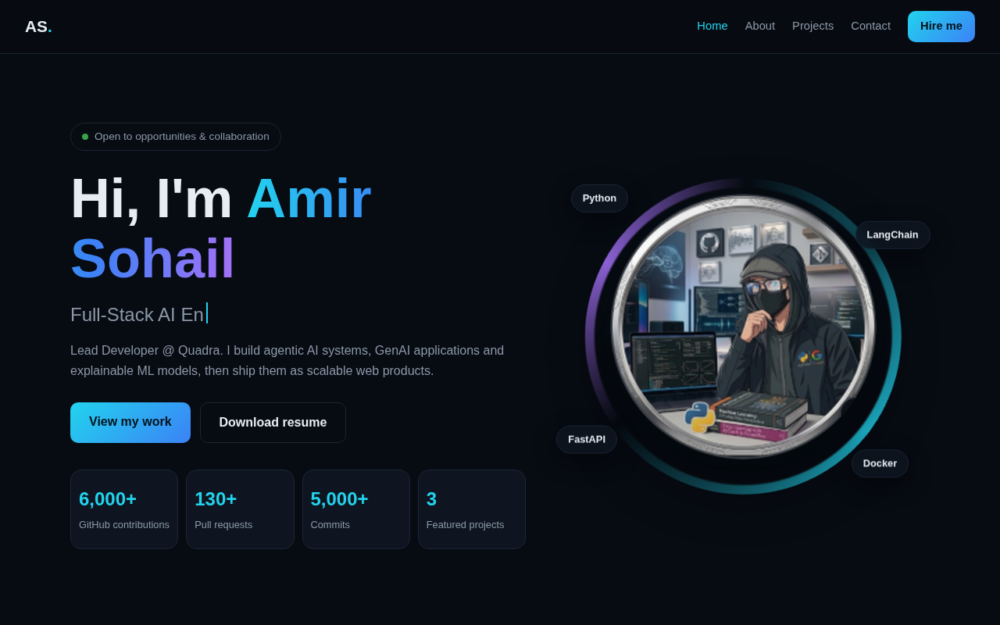

<div align="center">

# Amir Sohail | Portfolio

**Full-Stack AI Engineer & Lead Developer @ Quadra**

A fast, animated, multi-page portfolio built with plain HTML, CSS and JavaScript. No frameworks, no build step.

[**View live site**](https://amirsohail100.github.io/amir-sohail/) · [GitHub profile](https://github.com/amirsohail100) · [LinkedIn](https://linkedin.com/in/amir-sohail-ai)



</div>

---

## Features

- **Multi-page site:** Home, About, Projects, Project Detail and Contact, all sharing one navigation bar and footer.
- **Top projects on Home**, and a dedicated **All Projects** page with live **search** and type filters.
- **Data-driven projects:** every project is one object in `js/projects-data.js`. Add an object and it appears on the cards, in search and on its own detail page.
- **Polished animations:** typing role text, animated avatar ring, skills marquee, scroll progress bar, scroll reveals, cursor spotlight and 3D card tilt (respects `prefers-reduced-motion`).
- **Responsive** from phones to wide desktops.
- **Zero dependencies:** opens by double-clicking `index.html`.

## Pages

| Page           | File                         | What it shows                           |
| -------------- | ---------------------------- | --------------------------------------- |
| Home           | `index.html`                 | Hero, skills strip, top projects        |
| About          | `pages/about.html`           | Summary, skills by role, experience     |
| Projects       | `pages/projects.html`        | All projects with search and filters    |
| Project detail | `pages/project.html?id=<id>` | One project: preview, highlights, links |
| Contact        | `pages/contact.html`         | Contact cards and message form          |

## Project structure

```
amir-sohail/
├── index.html                  # Home (stays in the root)
├── favicon.svg
├── pages/
│   ├── about.html
│   ├── projects.html           # all projects with search and filters
│   ├── project.html            # one template for every project (uses ?id=)
│   └── contact.html
├── css/
│   └── style.css               # all styles and animations
├── js/
│   ├── projects-data.js        # all project objects (edit this to add projects)
│   └── script.js               # shared nav/footer, rendering, search, effects
├── assets/
│   ├── images/                 # avatar.png, preview.png
│   ├── ui/                     # project screenshots (paths set in projects-data.js)
│   └── resume/                 # Amir_Sohail_Resume.pdf
└── README.md
```

## Add a new project

Open `js/projects-data.js` and add an object to the `PROJECTS` list:

```js
{
  id: "my-project",              // unique slug, used in project.html?id=my-project
  name: "My Project",
  type: "AI",                    // filter chip and search ("AI", "ML", "Web" ...)
  live: "https://...",           // live demo URL ("" hides the button)
  repo: "https://github.com/amirsohail100/my-project",
  keywords: ["chatbot", "llm"],  // extra words for search
  top: true,                     // true = also shown on the Home page
  tag: "GenAI · Chat",
  desc: "One or two lines.",
  features: ["Point one", "Point two"],
  tech: ["Python", "LangChain"],
  image: "assets/ui/my-project.png",  // screenshot in assets/ui/ ("" shows a name placeholder)
  g: "linear-gradient(135deg,#6d28d9,#db2777)"  // placeholder background
}
```

## Run locally

```bash
git clone https://github.com/amirsohail100/amir-sohail.git
cd amir-sohail
# Option 1: double-click index.html
# Option 2: serve it
python -m http.server 8000      # then open http://localhost:8000
```

## Deploy

**Render (Static Site):** create a new Static Site from this repo, leave the build command empty and set the publish directory to `.`.

**GitHub Pages:** enable from _Settings → Pages → Deploy from a branch → `main` / root_. The site goes live at `https://amirsohail100.github.io/amir-sohail/`.

Skill logos on the Home marquee and About page come from the [Simple Icons](https://simpleicons.org) CDN and are mapped in `ICONS` at the top of `js/script.js`.

## Customize

| To change                               | Edit                                                                |
| --------------------------------------- | ------------------------------------------------------------------- |
| Projects                                | `js/projects-data.js`                                               |
| Skills, experience, typing roles, email | top of `js/script.js`                                               |
| Colors and fonts                        | `:root` variables in `css/style.css`                                |
| Project screenshots                     | add images to `assets/ui/` and set `image` in `js/projects-data.js` |
| Profile photo                           | replace `assets/images/avatar.png`                                  |
| Resume                                  | add `assets/resume/Amir_Sohail_Resume.pdf`                          |

## Contact

**Amir Sohail** · amirsohail10@gmail.com · [LinkedIn](https://linkedin.com/in/amir-sohail-ai) · [X](https://x.com/amirsohail2b)
